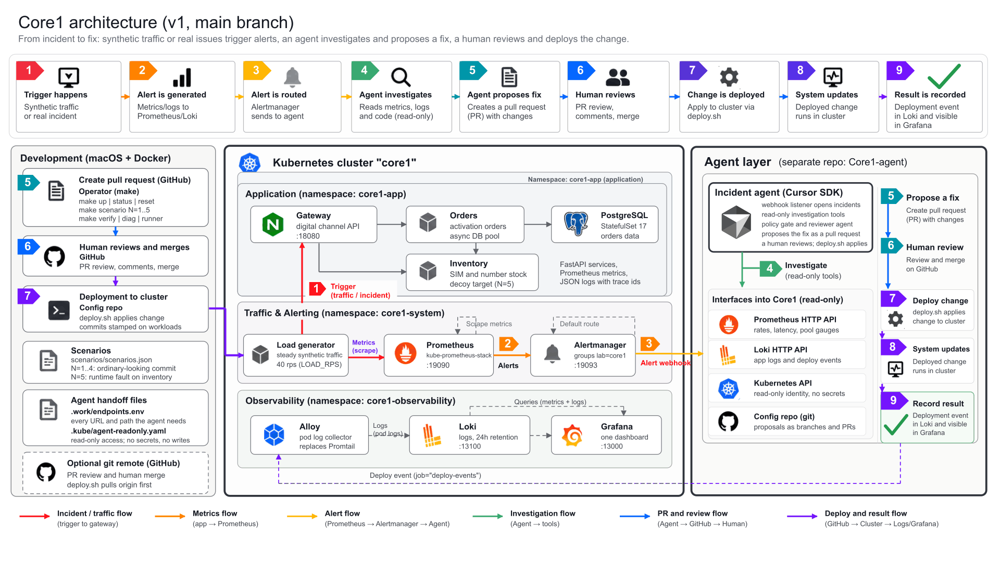

# Core1

Local Kubernetes lab you can break on purpose. Three services and Postgres, with Prometheus, Alertmanager, Grafana, and Loki. The config repo is the only way a change reaches the cluster. Five scripted incidents, one-command reset.

## Architecture



Current skin: Cascadia Mobile's activation platform. Gateway (channel API), orders (activation orders), inventory (SIM and number stock).

No agent code here. Core1_Incident-Agent talks to this lab through Prometheus, Loki, Alertmanager webhooks, a read-only kubeconfig, and git.

`main` is v1, tag `v1-frozen`, verified end to end with the incident agent. The `v2` branch is a multi-cluster rebuild and is not runnable yet.

## Prerequisites

- Docker running (Docker Desktop on macOS: at least 8 GB memory)
- `make`, `bash`, `git`, `curl`, `tar`
- `python3` 3.9+ (standard library only)

k3d, kubectl, and helm download into `.bin/` at pinned versions. Nothing is installed system-wide. `~/.kube` and other clusters are not touched.

## Quick start

```
cp .env.example .env        # optional; defaults work
make up                     # 10 to 20 minutes the first time
make status
make verify-quick           # about 2 minutes
make verify                 # every scenario, 30 to 45 minutes
```

Grafana URL is in `.work/endpoints.env`. Login `admin` / `GRAFANA_ADMIN_PASSWORD` in `.env` (default `core1-admin`).

## Commands

```
make up / down / reset      build everything; delete the cluster; return to the baseline tag
make status                 pods, config repo log, lab alerts, disk
make scenario N=4           inject scenario 4
make verify / verify-quick  acceptance tests; reports land in reports/
make diag                   bundle into logs/diag-<timestamp>/
make runner                 unattended runner (docs/RUNNER.md)
make help
```

## What is in the box

| Piece | Where | Notes |
|---|---|---|
| Cluster | k3d, one node, name `core1` | ports on 127.0.0.1 only; see `.env.example` |
| Services | `services/app` | gateway, orders (Postgres), inventory; FastAPI; Prometheus metrics; JSON logs with trace ids |
| Load | `cluster/lab-system.yaml` | synthetic traffic, default 40 rps |
| Metrics and alerts | `observability/` | kube-prometheus-stack; lab rules in `rules/`; one dashboard |
| Logs | `observability/loki`, `observability/alloy` | plain manifests, 24h retention |
| Config repo | `config-repo-template/` seeded into `.work/config-repo` | Kustomize; `deploy.sh` is the only write path |
| Scenarios | `scenarios/scenarios.json` | 4 change-caused faults, 1 decoy |
| Read-only identity | `rbac/agent-readonly.yaml` | `.kube/agent-readonly.yaml`; no secrets, no writes |
| Endpoints | `.work/endpoints.env` | URLs and paths the agent needs |

## Scenarios

| N | Fault | How it shows up |
|---|---|---|
| 1 | orders memory limit cut to 32Mi | OOMKilled, CrashLoopBackOff, rollout stuck |
| 2 | inventory image tag that was never built | ImagePullBackOff, rollout stuck |
| 3 | gateway readiness probe path changed | pods Running, never Ready, rollout stuck |
| 4 | orders DB pool capped at 1 | 503s from orders, 502s at the gateway |
| 5 | decoy: inventory slowed at runtime, no commit | p95 latency alert, no matching commit or deploy |

`make scenario N=4` commits and deploys, or sets the runtime fault. It refuses to start while `.work/scenario-active.json` exists. `make reset` restores the baseline tag, force-pushes `main`, and redeploys. `python3 scripts/scenario.py clear-runtime-faults` only clears the marker and the inventory fault. Answer file: `python3 scripts/scenario.py expected N`.

## Interfaces for the agent

- Alerts: Alertmanager posts lab alerts (`lab=core1`) to `ALERT_WEBHOOK_URL`. Default is the in-cluster sink. For the agent on the host: `http://host.k3d.internal:18090/alerts`.
- Metrics: Prometheus HTTP API. Logs: Loki (`{namespace="core1-app", app="orders"}`, `{job="deploy-events"}`). URLs are in `.work/endpoints.env`.
- Cluster: `.kube/agent-readonly.yaml` (get/list/watch; no secrets; no writes).
- Changes: `.work/config-repo`. `deploy.sh` applies HEAD and records a deploy event.

## Portability

Clone, Docker, `make up`. Versions in `versions.env`. Ports and sizes in `.env`. Tested on Apple Silicon macOS. Linux amd64/arm64 should work (not verified). Windows: WSL2 only, untested. Memory about 6 to 8 GB. Disk ceiling `DISK_CEILING_GB` (default 20).

More: `docs/DESIGN.md`, `docs/RUNNER.md`, `docs/DEVELOPING.md`, `docs/TRACING.md`.
